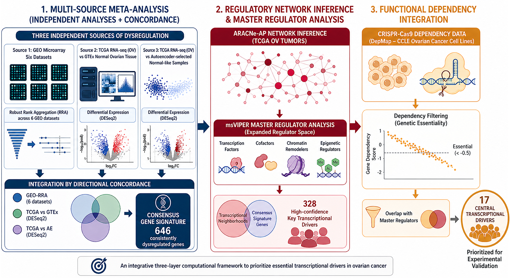

# Ovary Signatures

R pipeline supporting the manuscript:

> Ruiz-Hernández et al. *Integrative transcriptomic and network-guided functional dependency analysis reveals essential transcriptional drivers in ovarian cancer* (under revision).

The workflow has three layers: (1) a consensus differential-expression signature of ovarian serous cystadenocarcinoma from three sources (GEO microarrays, TCGA vs GTEx ovary, TCGA vs autoencoder-selected controls); (2) Master Regulator Analysis (ARACNe-AP + msVIPER) over transcription factors and cofactors; (3) prioritization of regulators with CRISPR dependency data from DepMap.



## Results in brief

- Consensus signature: 698 genes significant in the three sources (382 up, 316 down; direction by agreement of at least two sources).
- Master regulators: 2,436 regulons tested, 1,469 significant (BH-adjusted empirical p < 0.05); 227 above the elbow of the |NES| curve.
- DepMap 24Q4, 58 ovarian epithelial tumor lines: 64 consensus genes with median gene effect ≤ −1; 69 regulators enriched in them (Fisher test against the consensus genes with dependency data); 21 candidate regulators that are themselves dependencies (median gene effect ≤ −0.5) and expressed in the same lines (median TPM ≥ 1): ACTL6A, AURKB, BIRC5, CCNA2, CDK1, CDK2, CENPA, CHAF1B, CHEK1, DNMT1, GMNN, H2AZ1, ILF2, MIS18BP1, PLK1, PTTG1, SRSF2, TAF5, TIMELESS, TTF2, WDHD1.

## Layout and paths

The code lives in this repository; data and results live under a **data root** with the same folder names (`0_DGE_GTEx/`, `1_DGE_AE/`, …). Every script reads the data root from the environment variable `OVARY_SIGNATURES` (default `~/Ovary_signatures`, i.e. the repository itself used as data root):

```bash
export OVARY_SIGNATURES=/path/to/data_root
Rscript 5_MRA/5_0_ovary_mra.R
```

Other variables: `OCTAD_H5` (path to `octad.counts.and.tpm.h5`), `DEPMAP_DIR` (default `$OVARY_SIGNATURES/data/depmap_24Q4`), `ARACNE_JAR`, and the `MRA_*` settings documented in the header of `5_MRA/5_0_ovary_mra.R`.

## External inputs

| Input | Used by | Where to get it |
|---|---|---|
| `octad.counts.and.tpm.h5` | `0_1`, `1_1`, `3_0` | OCTAD expression file (see the `octad` package documentation) |
| GEO series (six microarray datasets) | `2_DEG_GEO/GEO_multi_RRA.R` | downloaded by the script with `GEOquery` |
| `TcgaTargetGtex_gene_expected_count.gz`, `TcgaTargetGTEX_phenotype.txt.gz` | `5_00` | UCSC Xena Toil hub, `https://toil.xenahubs.net/download/` → `data/xena/` |
| `Homo_sapiens_TF.txt`, `Homo_sapiens_Cof.txt` | `5_00` | AnimalTFDB → `data/regulators/` |
| `DatabaseExtract_v_1.01.txt` | `5_00` | Lambert et al. 2018, `https://humantfs.ccbr.utoronto.ca/download.php` → `data/regulators/` |
| `CRISPRGeneEffect.csv`, `Model.csv`, `OmicsExpressionProteinCodingGenesTPMLogp1.csv` | `6_*`, `7_2` | DepMap Public 24Q4, `https://depmap.org/portal/data_page/` → `data/depmap_24Q4/` |
| ARACNe-AP (`aracne.jar`) | `5_MRA/aracneap.sh` | `https://github.com/califano-lab/ARACNe-AP` |

## Order of execution

| Step | Script | Main outputs |
|---|---|---|
| 1 | `0_DGE_GTEx/0_1_Deseq_octad_GTEX.R` | `DE_full_OVARY_DESeq2_GTEx.rds` |
| 2 | `1_DGE_AE/1_1_Deseq_octad_AE.R` | `DE_full_OVARY_DESeq2_AE.rds` |
| 3 | `2_DEG_GEO/GEO_multi_RRA.R` | `GEO_ovarian_cancer_RRA_results.rds`, `GEO_ovarian_cancer_RRA_1row.rds` |
| 4 | `3_Consensus_DGE_analysis/3_0_Counts_norm.R` | normalized counts, metadata, gene annotation (`3_0_Counts_metadata/`) |
| 5 | `3_Consensus_DGE_analysis/3_1_DGE_list_shared.R` | consensus tables (`3_1_Core_signature/3_0_2_allgenes.tsv`), Venn diagram |
| 6 | `3_2_Heatmap.R`, `3_2_Volcano_plots_core_signature.R`, `3_3_Fano_poison.R` | heatmaps, volcano plots, dispersion analysis |
| 7 | `4_ORA_clusterProfiler/4_ORA_core_bar.R` | GO over-representation of the consensus |
| 8 | `5_MRA/5_00_expression_regulators.R` | `ov_tcga_vst.tsv`, `modulators_all_tf_tfc_mirna.txt`, `onlyTFs.txt` |
| 9 | `5_MRA/aracneap.sh` | `cancer_ovary_network_300bt_p1e-8.txt` |
| 10 | `5_MRA/5_0_ovary_mra.R` | Figures S1–S2, `signature_core.tsv`, regulon object, `core_mra.tsv` |
| 11 | `5_MRA/5_1_Elbow_TF.R` | top regulators by \|NES\| (elbow) |
| 12 | `6_Depmap_ovary/6_1_Heatmap_coregenes.R` → `6_2_MR_Enriched.R` → `6_3_Heatmap_TF.R` | dependency of consensus genes, enriched regulators, candidate drivers |
| 13 | `5_MRA/5_2_Circos_regulon_overlap.R`, `5_MRA/5_3_Circos_driver_hallmark.R` | circos plots of the candidates (need the raw network) |
| 14 | `7_Figures/7_1_…`, `7_2_…`, `7_3_…` | assembled manuscript figures (`7_3` reads the caches written by `7_2`) |
| 15 | `8_Survival_analysis/8_0_Clinical_metadata.R` → `8_1_Cox_drivers_survival.R` | TCGA-OV clinical table, Cox models (`8_1` reads the caches written by `7_2`) |

In step 3 the GEO cases are high-grade serous carcinomas and tumor epithelium only, and the controls are ovarian surface epithelium (low-grade and borderline tumors and microdissected stroma are left out). The probe-to-symbol mapping is read from `2_DEG_GEO/annotation/` (frozen from g:Profiler; version and date in the file header). Step 8 reads the gene annotation from the dictionaries frozen in `5_MRA/annotation/` (Ensembl release 115; each file records release and date in its header), so it does not depend on the Ensembl servers; delete a dictionary to rebuild it with biomaRt. With these inputs `5_00` writes a matrix that is byte-identical to the one used for the network, and an ARACNe-AP bootstrap run with the same seed reproduces the corresponding bootstrap file of the original run. `aracneap.sh` must be run from `$OVARY_SIGNATURES/5_MRA`.

Steps 9 and 10 are the expensive ones: the network takes about 6.5 h with 50 threads, and 10,000 permutations of msVIPER take a few minutes per signature with 55 workers. The permutation null of `5_0` uses one seed per permutation, so the result does not depend on the number of workers.

## Dependencies

R ≥ 4.4 with: `tidyverse`, `vroom`, `janitor`, `DESeq2`, `limma`, `octad`, `octad.db`, `GEOquery`, `RobustRankAggreg`, `gprofiler2`, `biomaRt`, `clusterProfiler`, `enrichplot`, `org.Hs.eg.db`, `msigdbr`, `viper`, `ComplexHeatmap`, `pheatmap`, `dynamicTreeCut`, `circlize`, `ggvenn`, `ggrepel`, `ggh4x`, `patchwork`, `png`, `effsize`, `TCGAbiolinks`, `survival`. Java for ARACNe-AP.

## License

GPL-3

## Contact

Open a GitHub issue, or contact the corresponding authors listed in the manuscript.
